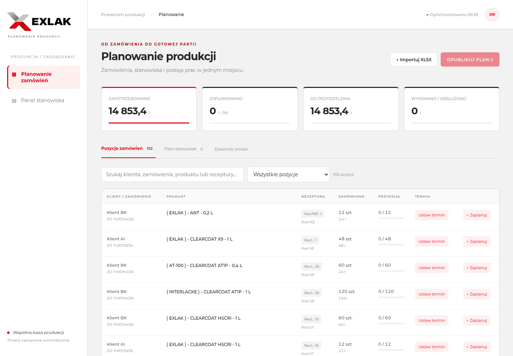

# EXLAK — planowanie i panel produkcji

Działająca pierwsza wersja aplikacji w języku polskim. Projekt udostępniony w repozytorium tomekc27/eta.

## Pobranie

Na stronie repozytorium wybierz **Code → Download ZIP**, rozpakuj archiwum i otwórz terminal w katalogu projektu. Wymagany Python 3.10 lub nowszy.

## Uruchomienie

```bash
cd eta
python -m venv .venv
.venv/bin/python -m pip install -r requirements.txt
.venv/bin/python -m uvicorn app:app --host 0.0.0.0 --port 8000
```

Po uruchomieniu na swoim komputerze otwórz w przeglądarce adres `http://localhost:8000`. W chmurze użyj dostępnego podglądu portu 8000. Wszystkie urządzenia muszą korzystać z tego samego serwera i bazy. Baza SQLite znajduje się w `data/planner.sqlite3`; należy uwzględnić ją w kopiach zapasowych. Można wskazać inną bazę przez zmienną `PLANNER_DB`.

## Przebieg pracy

1. Zaimportuj plik „Zestawienie do planu produkcyjnego.xlsx”. W pustej bazie można alternatywnie wczytać 102 pozycje przykładowe z 24.08.2026. Przykład zawiera rzeczywiste anonimowe dane z dostarczonego zestawienia, nie bieżące zamówienia ani rzeczywisty postęp.
2. Wyszukaj pozycję i wybierz „Zaplanuj”. Wskaż jedno z czterech potwierdzonych stanowisk: Automat, Półautomat lakiery, Półautomat utwardzacze lub Stan / etykietowanie. Wpisz ilość i dodatkową instrukcję. Jedną pozycję można podzielić między stanowiska; suma przydziałów nie przekroczy zamówienia.
3. Ustaw termin i priorytet. Widok „Plan stanowisk” grupuje zadania po recepturze i oblicza litry z ilości i objętości. Nie tworzy nadwyżek na zapas i nie zakłada czasów pracy na podstawie litrów.
4. Opublikuj zadania robocze. Operatorzy zobaczą je w panelach. Roboczy przydział można cofnąć. W tej wersji opublikowane przydziały są nieusuwalne.
5. Na ekranie dotykowym wybierz stanowisko. Rozpocznij zadanie, zgłaszaj dodatkowe wykonane sztuki lub wstrzymaj pracę z przyczyną. Pełne wykonanie kończy zadanie. Na jednym stanowisku może trwać jedno zadanie. Panel odświeża się co 5 sekund; wybrane stanowisko jest pamiętane na urządzeniu.
6. Sprawdź dziennik zmian oraz postęp zamówień.

## Import i interpretacja

Obsługiwany jest układ 10 kolumn z przesłanych zestawień. Pozycje muszą mieć klienta, numer zamówienia, nazwę produktu, dodatnią całkowitą ilość sztuk i dodatnią objętość. Litry są przeliczane, nie kopiowane z ręcznych sum. Import jest atomowy. Powtórny plik lub plik zawierający zamówienia już w bazie zostanie odrzucony, aby kolejne wersje zestawień nie dublowały pracy. Identyczne wiersze wewnątrz jednego pliku są zachowywane: bez identyfikatorów pozycji nie można bezpiecznie uznać ich za duplikaty.

Historyczne plany maszyn nie są automatycznie importowane jako wykonanie ani bieżący plan. Nie można na ich podstawie ustalić rzeczywistego stanu magazynu. Przydział „Stan / etykietowanie” jest decyzją planisty, nie rezerwacją w systemie magazynowym.

## Zakres pierwszej wersji

Wspólna trwała baza, ręczne planowanie ilości i terminów, publikacja, panel dotykowy, częściowe wykonanie, wstrzymania i dziennik. Brak logowania i ról: to wersja do wewnętrznego pilotażu w zaufanym środowisku, przed udostępnieniem poza nim wymaga kontroli dostępu. Brak automatycznej optymalizacji kolejności, kalendarza zmian, czasów przezbrojeń, integracji ERP i rozliczania surowców. Termin/priorytet są informacją dla planisty i operatora, nie automatycznym harmonogramem. Dziennik nie identyfikuje pracownika.

## Weryfikacja

Testy API (oddzielna tymczasowa baza):

```bash
.venv/bin/python -m pip install -r requirements-dev.txt
.venv/bin/python -m unittest -v test_app.py
```

Obejmują podział ilości, przekroczenie zamówienia, publikację i przejścia statusów, wykonanie, blokadę równoległych zadań na stanowisku, błędny import oraz duplikaty.

`browser_check.py` jest scenariuszem deweloperskim Playwright: uruchamiać wyłącznie z pustą, testową bazą i serwerem na porcie 8000. Zapisuje dane demonstracyjne i zgłoszenia testowe. Wymaga pakietu playwright oraz Chromium w `/usr/bin/chromium`.

## Wygląd EXLAK

Stylistyka oparta na publicznej stronie https://www.exlak.pl/ (sprawdzona 15.10.2026). Kolory z jej CSS: czerwień `#E30613`, grafit `#262626`, tło `#F2F2F2`, hover `#AA0C08`. Krój Montserrat jest zapisany lokalnie (Fontsource Variable 5.3.0, pakiet zweryfikowany przez SHA-512 z rejestru npm; licencja SIL OFL w static/fonts/LICENSE). Oryginalne, niezmienione logo SVG pobrano z https://www.exlak.pl/wp-content/themes/wi/images/exlak2024.svg i zapisano jako static/exlak-logo.svg. Logo i fonty nie wymagają dostępu do stron zewnętrznych podczas korzystania z aplikacji. Kolory statusów pozostają semantyczne.

## Podgląd


